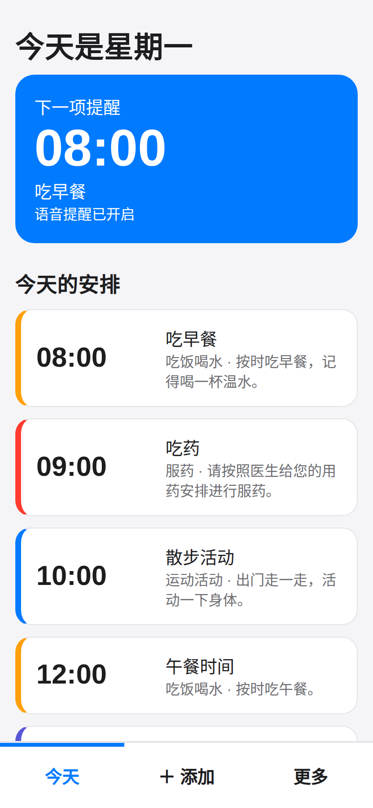
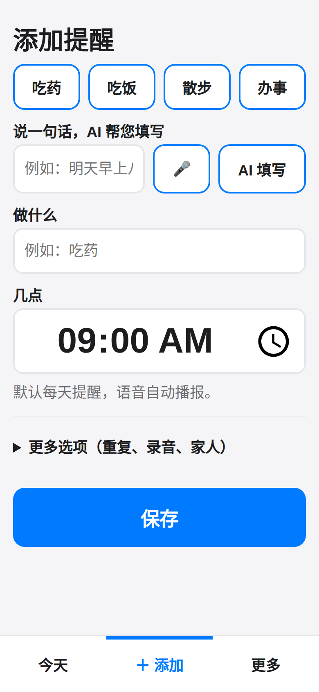
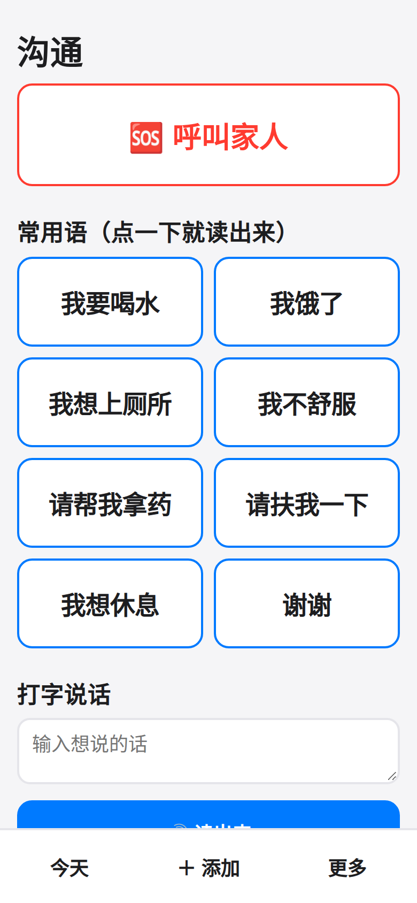
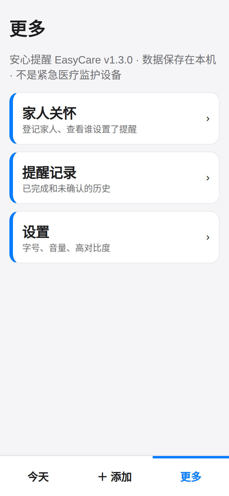
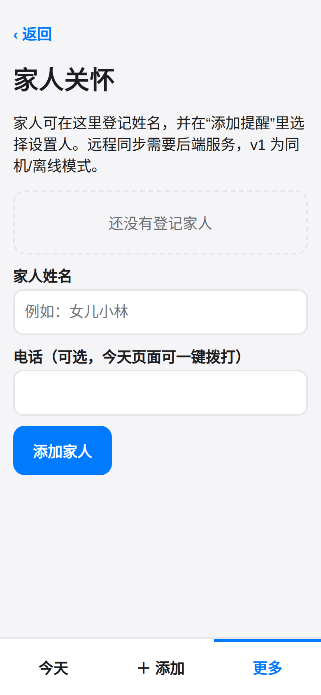
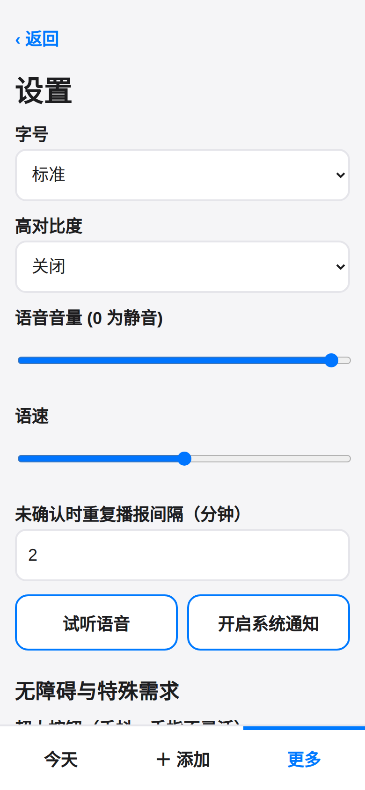

# AI提醒工具 · 安心提醒 EasyCare v1.3.0

离线优先的老人提醒软件：大字全屏视觉提醒 + 中文语音 + 家人录音，数据保存在本机。

老人不需要学习复杂操作，打开就能看到今天要做什么，到了时间软件会主动提醒。

## 快速开始

首次打开会自动载入 5 条日常安排（08:00 早餐、09:00 吃药、10:00 散步、12:00 午餐、21:00 休息），都可以自由修改或删除。

- 浏览器 / 手机 PWA：`npm run web`，打开提示的地址；手机部署到 HTTPS 后可“添加到主屏幕”。
- 桌面开发：`npm install && npm start`（Electron，Windows / macOS / Linux）。
- 家庭同步服务：`npm run server`（Node 18+，零依赖，默认 8787 端口，同时托管网页版），或用 Docker（见下）。

## 界面截图

## 打包（需在对应系统上构建）

- Windows 安装包：`npm run build:win` → `dist/`
- macOS：`npm run build:mac`（上架 / 分发需 Apple 开发者签名）
- Linux：`npm run build:linux`，生成 AppImage 与 deb

## 功能

- 今日首页：下一项提醒大卡片 + 倒计时 + 今日安排，一键确认；未确认可补充确认。
- 提醒管理：新建、修改、删除（二次确认）、暂停；重复：每天 / 每周指定日 / 每隔 N 天 / 只提醒一次；服药、吃饭喝水、运动活动、生活事务四类模板。
- 三级提醒：① 到点全屏大字 + 语音同时提醒；② 没确认按设定间隔重复播报；③ 重要提醒长时间未确认，通知家人（需家庭同步服务，见下）。未确认不等于没有完成。
- 语音提醒：系统中文 TTS，可调音量、语速；支持自定义播报语句、重复播报、语音确认（说“完成了”或“等一下”）。
- 说一句话建提醒：在添加页输入或语音说一句，如“明天早上八点提醒我去医院”，先离线解析填好，核对后保存；桌面版可装内置小模型（见下），再不行才用配好的 AI 接口；断网也能用离线解析。
- 家人录音：子女提前录一段自己的声音（≤30 秒），到时间播放录音而不是机器语音。
- 家人关怀：登记家人、查看谁设置了提醒、一键拨打家人电话；家人可在自己的设备上设置好，导出提醒文件发给老人导入。
- 生活记录：近 14 天完成记录、近 7 天完成情况柱状图、家人通知记录。
- 夜间安静时段：服药提醒不静音，其他提醒在安静时段不播报。
- 设置：大字模式、高对比度、字号三档；提醒文件导出 / 导入。
- 沟通页：常用语一点就读出来、打字转语音、听写字幕、呼叫家人；提醒可设提前预告（5–30 分钟）。
- 无障碍：超大按钮、闪屏加震动（听障）、读出今天的安排（视障）、键盘或开关确认、点屏幕任意位置确认、家人锁（防误触）。
- 视觉跟踪（默认关闭）：提醒响起时才开摄像头，不保存画面；未配 AI 时只做本地动作检测。AI 截图判断默认关闭，开启后才把缩小截图发给自己配的 AI 服务，只作参考，仍需本人点“我已经完成”。

## 最小内置模型（桌面版离线 AI）

- 目的：不依赖云端，桌面安装包自带小模型，离线完成“说一句话建提醒”。
- 组成：llama.cpp 的 `llama-server` + Qwen2.5-0.5B-Instruct（Q4_K_M，约 0.4GB）。内存占用约 0.6–1GB，普通电脑 CPU 即可，回答约 1–3 秒。
- 打包步骤：在目标系统上 `npm run get-llm`（联网从 llama.cpp 官方 GitHub Release 与 HuggingFace Qwen 官方仓库下载到 `llm/`，不校验哈希，请留意下载来源），再 `npm run build:win|mac|linux`。安装包会带上 `llm/`，程序启动时自动在本机 18080 端口拉起，只监听 127.0.0.1，退出时自动关闭。
- 没有 `llm/` 目录时程序照常运行，只是没有内置 AI；也可在设置里填 Ollama（`http://127.0.0.1:11434/v1`，密钥留空）或云端接口。`llm/` 目录约 0.4GB，已加入 `.gitignore`，不要提交到 GitHub。
- 限制：0.5B 模型很小，只适合把一句话转成固定格式的提醒，用户保存前仍会核对；**不适合**判断摄像头画面。视觉判断仍用本地动作检测，或自行配置带视觉的模型（如 Ollama 的视觉模型，体积更大）。
- 手机端：不内置模型（安装包会膨胀几百 MB、发热耗电），手机用云端接口，或连接家里电脑上的本机模型地址。

## 手机原生 App（Capacitor，iOS / Android）

一次性准备：`npm install`，然后 `npx cap add android`、`npx cap add ios`（iOS 需在 Mac 上，装 Xcode）。
日常：`npm run cap:android` / `npm run cap:ios` 同步网页代码并打开 Android Studio / Xcode，在里面运行或打包。

- 原生版使用系统本地通知：每次改动提醒后，自动重新登记未来 14 天、最多 60 条（iOS 上限 64 条）。锁屏、后台也会响铃弹出通知；点开通知后进入全屏提醒并播报语音。
- 在后台时无法自动播放语音 / 家人录音，仅有通知提示音，这是系统限制。
- 需手动补权限：Android `AndroidManifest.xml` 加 `SCHEDULE_EXACT_ALARM`、`CAMERA`、`RECORD_AUDIO`；iOS `Info.plist` 加 `NSCameraUsageDescription`、`NSMicrophoneUsageDescription`。
- 应用图标 / 启动图可用 `@capacitor/assets` 生成；上架需 Apple Developer / Google Play 账号与签名。

## 家庭同步服务（家人远程设置 + 未确认通知）

- 启动：`npm run server`（Node 18+，零依赖，默认 8787 端口，同时托管网页版）。Docker：`docker build -t easycare . && docker run -p 8787:8787 -v easycare:/data easycare`。
- 使用：在一台设备“设置 → 家庭同步”点“创建新家庭码”，把码和服务器地址填到老人、家人的所有设备；家人选“家人”身份（不会在家人手机上响铃），老人选“老人”。
- 家人在“添加”里设置的提醒 30 秒内同步到老人手机；完成情况同步回家人。勾选“重要提醒”后，老人 15 分钟未确认，服务器向 ntfy 主题推送（地址限定 `NOTIFY_ALLOW`，默认 `https://ntfy.sh/`）。
- 安全：家庭码即密钥，务必走 HTTPS（反向代理如 Caddy / Nginx），Android 原生 App 不允许明文 http。数据明文存于 `server/data.json`，含提醒与家人录音——请把服务器放在自己信任的机器上，不要把 `data.json` 公开或提交到 GitHub（已在 `.gitignore` 中排除）。建家庭码限速每小时每 IP 20 次。
- 局限：老人手机断网或应用被系统杀死时无法上报，也就无法通知家人；这是辅助手段，不能替代紧急监护。

## 隐私

- 基础提醒完全离线，不依赖云端 AI。
- 提醒、录音、家人信息默认只存本机（浏览器 localStorage）；录音总容量上限 2MB，单条超过约 1.2MB 会提示重录。
- 摄像头只在提醒响起且开启视觉跟踪时使用，画面不保存；AI 截图判断默认关闭。
- AI 接口地址、密钥、模型只存本机；浏览器版直连 AI 可能被 CORS 拦截，建议经自己的代理；桌面版已放行。生产环境应改为后端转发，不要把密钥提交到 GitHub。
- 服药提醒只按医嘱设置时间和次数，软件不决定剂量。本软件不是紧急医疗监护设备。

## 已知限制

- iOS 网页在后台 / 锁屏无法准时触发，需保持前台；要可靠后台提醒需原生 App（如 Capacitor + 本地通知）。
- 家人“远程”设置 / 通知需要后端，v1.1 仅本机登记 + 自建同步服务。
- 录音以 base64 存本机，大量录音建议后续迁移 IndexedDB / SQLite。

## 无障碍与特殊需求（设置 → 无障碍与特殊需求）

- 视障：提醒响起时焦点自动落在“我已经完成”按钮（读屏软件可直接朗读）；今天页可显示“读出今天的安排”；条目可用 Tab 聚焦、回车打开；类型用文字标注，不只靠颜色。
- 听障：闪屏（1 秒一次，彩色 / 白色交替）加每 5 秒一次强震动；全屏大字和系统通知本来就不依赖声音。
- 手部不灵活 / 震颤：超大按钮模式；键盘或开关确认（空格 / 回车 = 完成，N = 稍后），可接外接开关设备。
- 记忆或认知障碍：家人锁，设置密码后老人只能看“今天”和确认，进入“添加 / 更多”需家人输入密码（5 分钟内免再输）。
- 说明：这些适配未经真实使用者测试。上架前建议请相应人群试用，并对照 WCAG 2.2 AA 自查；iOS 的震动网页接口不可用。闪屏为每秒一次的彩色与白色交替，光敏性癫痫患者请勿开启。

## 沟通与行动辅助（设置 → 无障碍与特殊需求）

- 言语障碍 / 失语：开启“沟通”页后，底部多一个“沟通”按钮：大块常用语（点一下读出来，可增删）、打字转语音、**呼叫家人**（记录求助并同步给家人，家人首页显示红色提示；配置了 ntfy 会推送。这不是急救服务，紧急情况需拨打当地急救电话）。
- 听力障碍交流：“听写字幕”把别人说的话实时变成大字（依赖设备的语音识别，嘈杂环境准确率低）。
- 行动不便 / 轮椅：提醒可设“提前预告”（5–30 分钟，给转移和准备留时间，原生 App 也会提前发通知）；“点屏幕任意位置确认”；超大按钮；全部操作在拇指可及的底部。
- 以上功能同样未经真实使用者测试，建议找相应人群试用后再调整。

## 测试

`npm test`：47 项，覆盖种子数据、离线中文解析、重复规则（每天 / 每周 / 每隔 N 天 / 单次）、输入校验、本地小模型免密钥调用与 JSON 模式、get-llm.js 官方下载源、Electron 路径守卫、提前预告、沟通常用语。另有 `node tests/server-test.js` 11 项：启动同步服务器实测建家庭码、推 / 拉提醒、错码 401、通知白名单、服务器截断、呼叫求助记录同步。

## 发布到 GitHub

1. 在 GitHub 新建仓库（库房名 `AI提醒工具`，仓库地址 `enoonc-sketch/ai-reminder-tool`），不要勾选自动生成文件。
2. 把本源码包解压后推送（不要用应用推送 `.github/workflows/`，会因权限被拒绝；工作流文件在 `.github/workflows/build.yml`，请在网页上手动上传）。
3. 打 tag `v1.3.0` 可触发打包（见工作流）。

## 版本

见 `CHANGELOG.md`。当前版本 v1.3.0。

## 许可证

MIT，见 `LICENSE`。
